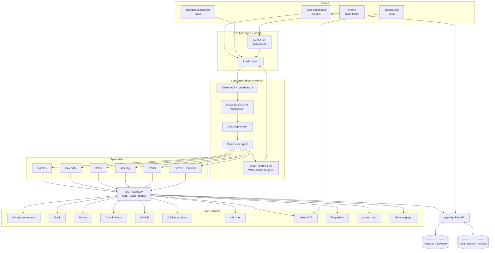
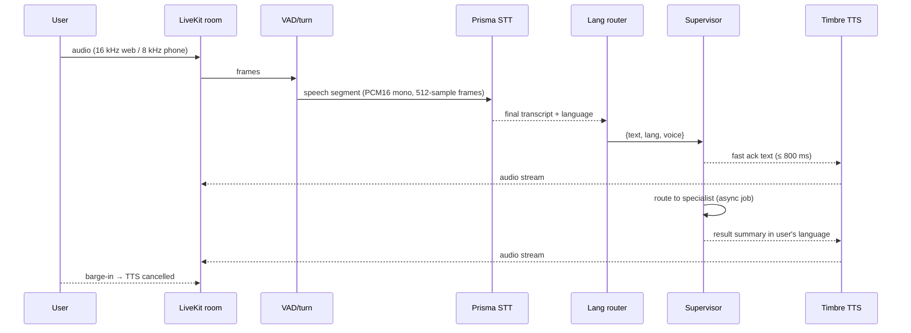
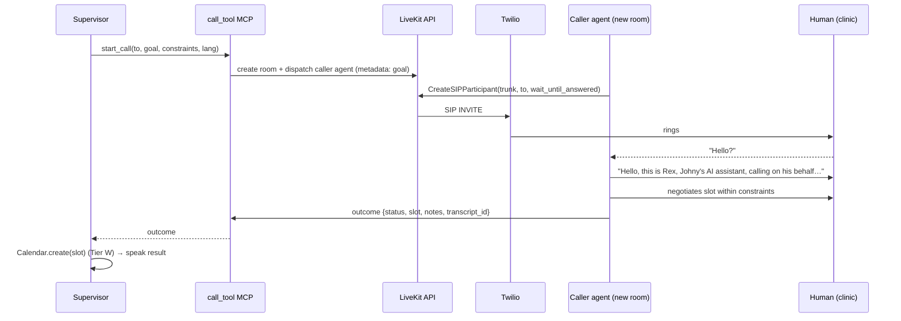
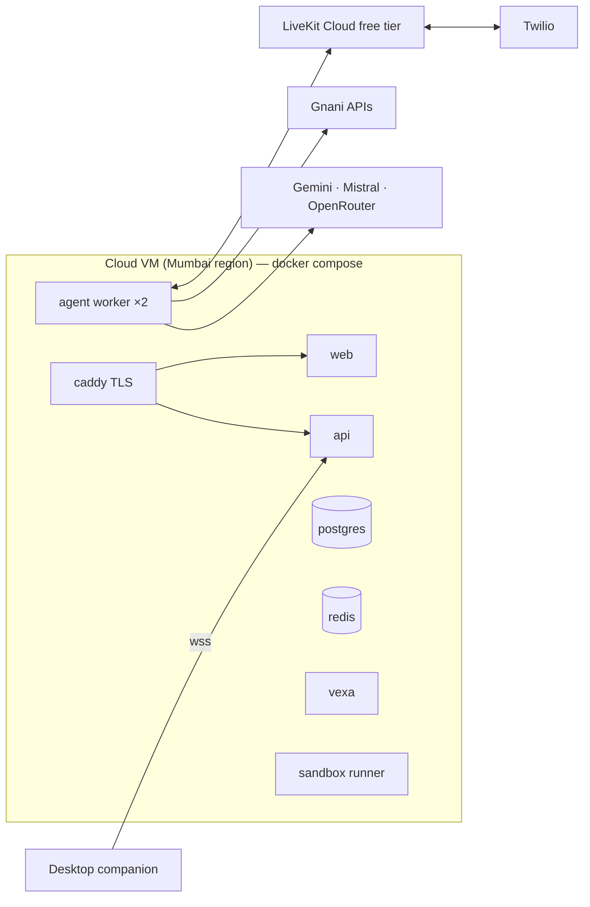

# Architecture — Rex

Status: v1 design, 24 Oct 2026. Owners: Johny (realtime + clients), Shanky (orchestration + tools + backend).

## 1. Principles

1. **Fast talker, slow thinker.** The voice loop never waits on a long task. It speaks a fast ack, hands the job to a background worker, and reports back.
2. **Supervisor + specialists.** One router agent, six specialists with small toolsets. Fewer tools per prompt = better tool choice and lower latency.
3. **Everything is MCP.** Every capability is an MCP tool behind one gateway. Adding a tool = adding config, not code.
4. **Permission tiers at the gateway**, not in prompts. The LLM cannot bypass them.
5. **Every action is an event.** Timeline, undo, debugging and the demo all read the same event stream.
6. **Gnani on every voice path.** Prisma for ears, Timbre for mouth; fallbacks only for languages Gnani does not cover.

## 2. System context



## 3. Components

### 3.1 Clients (Johny)

| Client | Tech | Responsibilities |
|---|---|---|
| Web dashboard | Next.js 15, `@livekit/components-react`, Tailwind | Join room, push-to-talk, live transcript, timeline, approvals, connections page, settings |
| Desktop companion | Tauri 2 (Rust + TS) | Tray icon, global hotkey push-to-talk, screen capture (region / active window), "watching" indicator, local `screen_tool` MCP server bridge |
| Phone | Twilio number → LiveKit SIP | Outbound calls placed by the Caller; stretch: inbound receptionist |
| Meeting bot | Vexa (self-host or hosted) | Joins Meet/Zoom/Teams, records, exposes transcripts + audio |

### 3.2 Realtime voice loop (Johny) — `apps/agent/voice/`



- Framework: **LiveKit Agents 1.x** with `livekit-plugins-gnani` (STT). TTS through the Gnani WebSocket API (custom LiveKit TTS adapter if no official TTS plugin; reference: `pipecat-gnani`'s `GnaniTTSService`).
- STT: Prisma via WebSocket, `format=transcribe` so dates/numbers come back normalised. 8 kHz for phone legs.
- Turn-taking: Silero VAD + LiveKit turn detector. Gnani sends **finals only**, so end-of-speech timing matters — tune `min_silence_duration` (start 450 ms).
- Barge-in: TTS is interruptible; on user speech the current utterance is cancelled and the supervisor is told what was actually spoken.

### 3.3 Language router (Johny) — `apps/agent/voice/lang.py`

| Detected language | STT | TTS | Notes |
|---|---|---|---|
| en-IN, hi-IN, bn, gu, kn, ml, mr, pa, ta, te (-IN) | Gnani Prisma | Gnani Timbre (matching voice) | Default path |
| Hinglish / code-mixed | Prisma `en-IN,hi-IN` bilingual (batch) or hi-IN streaming | Timbre Hindi voice | Supervisor keeps code-mixed style |
| Anything else (e.g. fr, es, ar, or Odia/Assamese if unsupported) | faster-whisper (local) | Fallback TTS (D-012) | Logged as "fallback" in metrics |

Language is locked per turn and stored on the session so replies match.

### 3.4 Supervisor and specialists (Shanky) — `apps/agent/brain/`

- Orchestration: **LangGraph** state machine. Nodes: `understand → route → (specialist subgraph) → confirm? → act → summarise`.
- Supervisor prompt holds: user profile, current time + timezone (Asia/Kolkata), language, short memory recall, list of specialists with one-line descriptions. It **does not** see raw tool lists.
- Each specialist is a subgraph with its own model and ≤ 10 tools:

| Specialist | Model (via llm_router) | MCP tools | Tier mix |
|---|---|---|---|
| Comms | Mistral Small | slack.read/post, gmail.* (stretch) | R, A |
| Calendar | Gemini Flash | calendar.freebusy/create/update/delete | R, W |
| Caller | Gemini Flash (planning) + realtime sub-session | call_tool.start/status/hangup, calendar.create | A |
| Meeting | Mistral (summaries) | vexa.*, minutes.make, notion.create, slack.post | R, W, A |
| Coder | Codestral | sandbox.*, github.*, fs.*, git.* | R, W, A (merge) |
| Screen + Browser | Gemini (vision) | screen.capture/describe, playwright.* | R, A |

- **Fast ack rule**: if the router predicts > 1 tool call or a specialist marked `slow` (Caller, Meeting, Coder), it emits an ack immediately and enqueues a job.

### 3.5 LLM router (Shanky) — `packages/llm_router/`

```
route(task_kind, needs_vision, needs_code, lang) -> ModelSpec
```

| Task kind | Primary | Fallback |
|---|---|---|
| supervise / plan / tool-call | Gemini 2.x Flash (free tier) | Mistral Small |
| summarise / minutes / translate | Mistral Small | Gemini Flash |
| code | Codestral | Gemini |
| vision (screen) | Gemini Flash | — |
| any (rate-limited) | OpenRouter free model | — |

Router handles rate-limit (429) backoff and automatic fallback, and logs model + tokens per call.

### 3.6 Caller sub-system (Johny) — `packages/mcp_servers/call_tool/`



- Caller agent = a separate LiveKit agent session (same voice stack at 8 kHz) whose instructions are the goal + constraints + disclosure line.
- Tools inside the call: `propose_slot`, `confirm_booking`, `end_call` (EndCallTool), `escalate_to_user` (stretch: bridges the user in).
- Twilio trial: only verified numbers can be called → we verify Johny's and Shanky's phones; the demo uses those. A trial message plays before the call — acceptable and honest.

### 3.7 Meeting pipeline (Shanky, STT by Johny)

1. `meeting.join(url)` → Vexa bot joins; announces recording.
2. On end: fetch audio → **Gnani batch STT** (bilingual `en-IN,hi-IN` where useful) → diarised transcript.
3. Mistral produces minutes: summary, decisions, action items (owner, due date), open questions — strict JSON schema.
4. Notion page created from template; Slack post with link; action items optionally become calendar holds (Tier W).

Vexa transcripts are polled (no WebSocket yet), so minutes are produced after the meeting.

### 3.8 Coder sandbox (Shanky)

- One Docker container per job from `infra/sandbox.Dockerfile` (git, python, node, test runners), no host mounts, network limited to GitHub + package registries, 10-minute wall clock.
- Loop: clone → locate (ripgrep + LLM) → patch → run tests → retry ≤ 3 → push branch → open **draft** PR (Tier W). Merging is Tier A.

### 3.9 Screen + browser (Johny: capture; Shanky: browser)

- Desktop companion captures the active window/region **only when asked** ("ye kya hai?") or while "watch mode" is visibly on.
- Text first: OS accessibility text where available, OCR fallback, screenshot only if needed (cheaper and more private — pattern from screenpipe).
- Exposed as local MCP `screen_tool` over a secure WebSocket bridge to the gateway.
- Browser: Playwright MCP in a dedicated browser profile; every submit/purchase/login is Tier A.

### 3.10 MCP Gateway (Shanky) — `packages/mcp_gateway/`

Responsibilities: connect to all servers (stdio / streamable HTTP), namespace tools (`slack.post_message`), enforce tiers, inject per-user OAuth tokens, timeouts + retry, write `action_events`, emit approval requests, support **undo** where a compensating action exists. Detail: [MCP_CONNECTION.md](MCP_CONNECTION.md).

### 3.11 Backend API (Shanky) — `apps/api/`

FastAPI + SQLAlchemy + Alembic. Auth, users, OAuth connections, sessions, jobs, timeline (SSE), approvals, webhooks (Twilio status, Vexa), LiveKit token minting. Detail: [API.md](API.md), [DATABASE.md](DATABASE.md), [BACKEND_CONTEXT.md](BACKEND_CONTEXT.md).

## 4. Data flow of one request (the dentist example)

1. Johny: "Dentist ko call karke Saturday shaam ka slot book karo." (web, 16 kHz)
2. Prisma STT → `hi-IN` transcript; language locked to Hindi/Hinglish.
3. Supervisor → intent `book_appointment_by_phone`, specialist **Caller** (slow) → fast ack "Theek hai, dentist ko call kar raha hoon."
4. Job enqueued; gateway checks Tier A for `call_tool.start_call` → approval prompt "Dr. Mehta's clinic ko call karoon?" → "haan".
5. Caller agent dials via Twilio, books "Saturday 6 PM".
6. Outcome → Calendar specialist creates event (Tier W, announced, undo available) → Maps adds ETA.
7. Supervisor speaks: "Saturday shaam 6 baje ka appointment ho gaya, calendar mein daal diya. Wahan pahunchne mein 25 minute lagenge."
8. Timeline shows 4 events: approval, call, calendar.create, maps.eta.

## 5. Deployment



- Dev: everything local via `docker compose` + LiveKit Cloud project.
- Demo: one VM (4 vCPU / 8 GB) in an Indian region; LiveKit Cloud for media; secrets via `.env` on the VM, never in git.

## 6. Observability

- **Langfuse** (self-hosted or cloud free) traces: one trace per user turn, spans for STT, router, each LLM call, each tool call, TTS.
- Metrics per turn: `stt_ms`, `llm_first_token_ms`, `tts_first_audio_ms`, `total_ms`, `lang`, `fallback_used`.
- Structured JSON logs with `session_id`, `turn_id`, `job_id`. See [DEBUGGING.md](DEBUGGING.md).

## 7. Failure modes and responses

| Failure | Response |
|---|---|
| STT timeout / empty | "Maaf kijiye, phir se boliye?" |
| LLM 429 | Router falls back to next model; spoken ack unaffected |
| Tool timeout | One retry, then honest spoken failure + timeline card with "retry" |
| Call not answered | Report "no answer", offer to retry in 10 min |
| Approval not given within 30 s | Action cancelled, logged |
| Sandbox tests fail 3× | Draft PR not opened; summary of attempts spoken |
