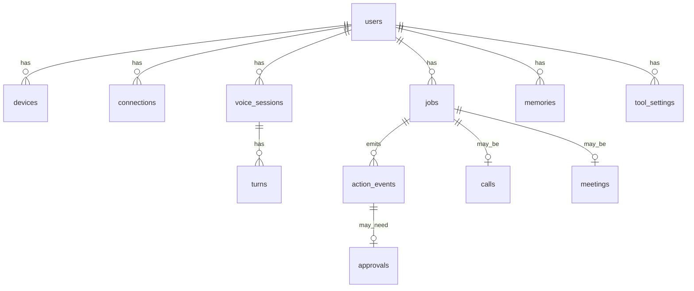

# Database

Postgres 16 + pgvector. Migrations: Alembic in `apps/api/migrations`. Owner: **Shanky**.

## ER diagram

## Tables

### users
| column | type | notes |
|---|---|---|
| id | uuid pk | v7 |
| email | citext unique | |
| display_name | text | |
| preferred_lang | text | BCP-47, e.g. `hi-IN` |
| timezone | text | default `Asia/Kolkata` |
| created_at | timestamptz | |

### devices
`id, user_id fk, name, kind ('desktop'), token_hash, last_seen_at, revoked_at`

### connections
| column | type | notes |
|---|---|---|
| id | uuid pk | |
| user_id | uuid fk | |
| provider | text | `google`, `slack`, `notion`, `github` |
| scopes | text[] | |
| token_enc | bytea | AES-GCM with `TOKEN_ENC_KEY` |
| refresh_enc | bytea | nullable |
| expires_at | timestamptz | |
| unique(user_id, provider) | | |

### voice_sessions
`id, user_id, client ('web'|'desktop'|'phone'), room, started_at, ended_at, lang_first`

### turns
| column | type | notes |
|---|---|---|
| id | uuid pk | |
| session_id | uuid fk | |
| role | text | `user` / `assistant` |
| text | text | |
| lang | text | detected / spoken language |
| stt_ms, llm_ms, tts_ms, total_ms | int | latency metrics |
| fallback_used | bool | non-Gnani STT/TTS |
| created_at | timestamptz | |

### jobs
`id, user_id, session_id, specialist, intent, status ('queued'|'running'|'awaiting_approval'|'succeeded'|'failed'|'cancelled'), input jsonb, output jsonb, error text, created_at, updated_at`

### action_events (the timeline)
| column | type | notes |
|---|---|---|
| id | uuid pk | |
| user_id, job_id | uuid fk | |
| tool | text | namespaced |
| tier | char(1) | R/W/A |
| status | text | see API `ActionEvent` |
| summary | text | in user's language |
| args_redacted, result_redacted | jsonb | PII removed |
| undo | jsonb | compensating call `{tool, args}` or null |
| trace_id | text | Langfuse link |
| created_at | timestamptz | index (user_id, created_at desc) |

### approvals
`id, action_event_id fk, status ('pending'|'approved'|'denied'|'expired'), decided_by ('voice'|'web'), decided_at, expires_at`

### calls
`id, job_id, to_number_masked, provider_sid, goal, constraints jsonb, outcome jsonb (CallOutcome), duration_s, started_at, ended_at`

### meetings
`id, job_id, url, platform, bot_id, status, transcript jsonb, minutes jsonb (Minutes), notion_url, slack_ts, created_at`

### memories (stretch, F15)
`id, user_id, kind ('person'|'preference'|'fact'|'decision'), text, embedding vector(768), source_event_id, created_at` · HNSW index on embedding.

### tool_settings
`user_id, server, enabled bool, tier_override char(1) null` (only to make a tier *stricter*).

## Rules

- No raw phone numbers stored: `to_number_masked` (`+91 9xxxx xx123`); the real number lives only in the encrypted contact store or `.env` for test numbers.
- `args_redacted` passes through the redactor (emails, phones, tokens).
- Retention: transcripts 30 days, action events 90 days (configurable); delete-my-data endpoint wipes everything for a user.
- Seeds (`make seed`) are 100 % synthetic.
