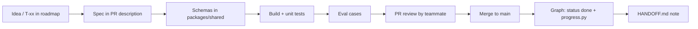

# Feature Development Workflow

How a feature goes from idea to merged, for humans and AI agents alike.

## 1. Lifecycle



## 2. Branches and PRs

- Branch: `t-31-caller-agent` (task id + slug).
- PR title: `T-31: caller agent books slot via Twilio`.
- PR body template:

```
## What
## Why (link T-xx / F-xx)
## How to test
## Screenshots / audio clip (synthetic)
## Checklist
- [ ] make check green
- [ ] new tool has tier in mcp_servers.yaml
- [ ] eval cases added (≥3) if prompts/routing changed
- [ ] docs updated (which?)
- [ ] graph updated + PROGRESS.md regenerated
```

- One reviewer (the other teammate). Review within 4 hours during the build window.
- Squash merge. `main` is always demo-able after 31 Oct.

## 3. Recipes

### Add a new specialist
1. `apps/agent/brain/specialists/<name>.py` — subgraph with system prompt, model via `llm_router.route(...)`, tool allow-list.
2. Register in `brain/registry.py` with a one-line description (the supervisor routes on this).
3. Mark `slow=True` if it needs the job queue.
4. Add ≥ 10 routing eval utterances across languages in `evals/routing.yaml`.

### Add a new MCP tool / skill
Follow MCP_CONNECTION.md §5.

### Add a voice behaviour (e.g. new confirmation word)
Edit `apps/agent/voice/confirmations.py`; add test utterances in 3 languages; update DESIGN.md §1.

### Add a dashboard screen
Route in `apps/web/app/<screen>/page.tsx`; data via typed client from `packages/shared`; SSE events through `useTimeline()`; follow DESIGN.md tokens.

## 4. Testing levels

| Level | Tool | Runs |
|---|---|---|
| Unit | pytest / vitest | every commit |
| Tool contract | fake MCP servers | every commit |
| Routing evals | `make eval` (60+ utterances) | every PR touching prompts |
| Voice smoke | `scripts/replay_turn.py` on saved synthetic audio | daily |
| End-to-end demo | manual demo script, 10 runs | Phase 5 onward, daily |

## 5. Feature flags

`settings.FEATURES = {"browser": True, "gmail": False, "memory": False, ...}` — turn stretch features off for the demo if unstable.

## 6. Definition of done
See AGENTS.md. Plus: the feature appears correctly on the timeline and speaks its result in at least Hindi and English.
