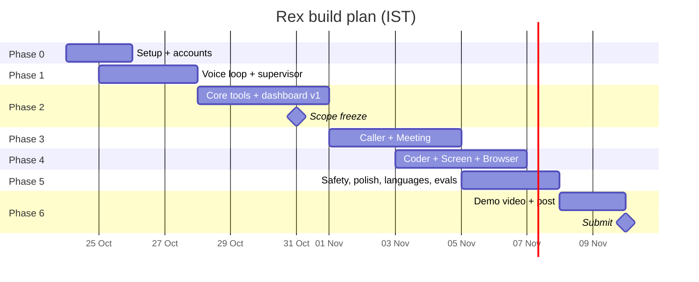

# Implementation Roadmap — phase-wise distribution

17 days, 7 phases, 2 people. Every task has an ID (`T-xx`) that also exists as an entity in the project graph (`memory/project-graph.jsonl`) — update status there and run `python scripts/progress.py` to refresh [PROGRESS.md](PROGRESS.md).

## Re-plan — 26 Oct 2026 (supersedes dates below where they differ)

Full review and plan: [Rex — Progress Review & Next-Phase Plan](https://claude.ai/artifact/4nY8k2exraJUhLJNhnEp9q).

| Task | Change | Owner | Due |
|---|---|---|---|
| T-02 | Credentials: Google OAuth, Slack bot + team ID, Notion token + page, Vexa key, Twilio SID + number | Johny | 27 Oct |
| T-36 (new) | Route Coder + Meeting specialists through the gateway | Shanky | 27 Oct |
| T-37 (new) | Tool surface + tier fixes (rex ≤ 25 tools, sandbox coder-only, `execute`/`join_meeting` Tier A, browser off until real, undo expiry) | Shanky | 27 Oct |
| T-10/11/12 | Close the live voice loop (p50 ≤ 1.8 s on 3 sessions) | Johny | 28 Oct |
| T-22/23/28 | Reopened until `check_phase2.py --live` passes | Shanky | 28 Oct |
| T-29 | Gate G2: `--live` all green + all 70 evals ≥ 90 % | Shanky | 28 Oct |
| T-30 → T-31 | Twilio SIP trunk → Caller agent (**critical path**) | Johny | 29 Oct → 1 Nov |
| T-32 | `call_tool` server — moved to Shanky | Shanky | 2 Nov |
| T-34 | Gnani batch STT for meetings — moved to Shanky | Shanky | 31 Oct |
| T-38 (new) | Real Playwright browser (replace mock) | Shanky | 2 Nov |
| T-42/43 | Browser screen-share instead of desktop app (desktop = stretch) | Johny | 4 Nov |
| T-50 | **Cut** (English-only, D-023) | — | — |
| T-54 | Evals + latency + 10× dry runs — moved to Shanky | Shanky | 7 Nov |
| Milestones | Gate G3 phone booking 2 Nov · **feature freeze 3 Nov** · video 8 Nov · **submit 9 Nov** (10 Nov = buffer) | Both | |

Fallback if the Caller slips past 2 Nov: a labelled LiveKit browser "call" with Shanky playing the clinic.

## Ownership at a glance

| Track | Johny | Shanky |
|---|---|---|
| Realtime voice (LiveKit, Gnani STT/TTS, VAD, barge-in) | **Owner** | Reviewer |
| Language routing + fallback STT/TTS | **Owner** | — |
| Twilio telephony + Caller agent | **Owner** | Reviewer |
| Desktop companion (Tauri) + screen capture | **Owner** | — |
| Web dashboard (frontend) | **Owner** | API contracts |
| Supervisor + LangGraph + LLM router | Reviewer | **Owner** |
| MCP gateway + tool servers + permission tiers | — | **Owner** |
| Backend API, DB, auth, OAuth | — | **Owner** |
| Meeting pipeline | Batch STT step | **Owner** |
| Coder sandbox | — | **Owner** |
| Browser control (Playwright) | — | **Owner** |
| Evals, demo script, video, social post | **Co-owner** | **Co-owner** |

Rule of thumb: **Johny owns everything that touches audio, devices or pixels; Shanky owns everything that touches tools, data or models.** Interfaces between them are frozen in `packages/shared` (Pydantic → TS types) by the end of Phase 1.

## Timeline

---

## Phase 0 — Setup (24–25 Oct) · both

**Goal:** both laptops can run the skeleton; every account and key exists.

| ID | Task | Owner | Done when |
|---|---|---|---|
| T-01 | Monorepo scaffold (uv workspace + pnpm), lint, pre-commit, CI | Shanky | `make check` passes in CI |
| T-02 | Accounts: Gnani credits, LiveKit Cloud, Twilio trial (+ verify both phones), Google Cloud project + OAuth consent (test users), Slack workspace + bot, Notion integration, GitHub PAT, Gemini + Mistral keys | Johny | Every key in the team vault; `.env.example` complete |
| T-03 | docker-compose: postgres, redis, (vexa), langfuse | Shanky | `docker compose up` healthy |
| T-04 | Project graph + claude-mem set up on both machines (`cp mcp.json.example .mcp.json`) | Johny | `progress.py` renders PROGRESS.md |
| T-05 | Read docs pack; agree on interfaces in `packages/shared` | Both | Schemas merged |

**Exit gate G0:** both can run `make dev` and see the empty dashboard.

## Phase 1 — Voice loop + supervisor skeleton (25–27 Oct)

**Goal:** talk to Rex in Hinglish in the browser and get a spoken answer from Gemini.

| ID | Task | Owner | Done when |
|---|---|---|---|
| T-10 | LiveKit agent worker with Gnani Prisma STT (WebSocket) | Johny | Live transcript appears in dashboard |
| T-11 | Gnani Timbre TTS adapter (WebSocket, interruptible) | Johny | Barge-in cancels speech < 200 ms |
| T-12 | VAD + turn detection tuning; latency metrics per turn | Johny | p50 total ≤ 1.8 s logged |
| T-13 | LLM router v1 (Gemini primary, Mistral fallback, 429 handling) | Shanky | Unit tests pass; fallback demo |
| T-14 | Supervisor LangGraph v1: understand → route → reply; fast-ack rule | Shanky | Answers small talk; routes stub specialists |
| T-15 | Web dashboard v0: join room, push-to-talk, transcript | Johny | Usable on laptop and phone browser |
| T-16 | API v0: auth (magic link), LiveKit token endpoint, sessions | Shanky | Token minted for logged-in user |

**Exit gate G1:** "Namaste Rex, aaj kaun sa din hai?" answered in Hindi in < 2 s.

## Phase 2 — Core tools + dashboard v1 (28–31 Oct)

**Goal:** calendar, Slack, Notion and Maps work by voice through the gateway.

| ID | Task | Owner | Done when |
|---|---|---|---|
| T-20 | MCP gateway v1: connect, namespace, timeouts, audit `action_events` | Shanky | All tools listed in `/v1/tools` |
| T-21 | Permission tiers R/W/A + approval request flow (API + Redis) | Shanky | Tier A blocks until approved |
| T-22 | Google OAuth connection + Calendar specialist | Shanky | "Kal 4 baje meeting rakho" creates event |
| T-23 | Slack + Notion specialists (Comms, Notes) | Shanky | Post + page created by voice |
| T-24 | Maps tools: place search, ETA, share pin | Shanky | ETA spoken; pin posted to Slack |
| T-25 | Dashboard v1: timeline (SSE), approval cards, connections page | Johny | Approve/deny works from UI |
| T-26 | Voice approvals ("haan / nahi / ruko") | Johny | Spoken approval resolves the request |
| T-27 | Eval set v1: 60 utterances (Hinglish + 3 Indian langs) → expected specialist | Both | Routing accuracy measured |

**Exit gate G2 / Scope freeze (31 Oct):** demo steps 1 and 3 work. Anything not started is cut or moved to Stretch.

## Phase 3 — Caller + Meeting (1–4 Nov)

| ID | Task | Owner | Done when |
|---|---|---|---|
| T-30 | Twilio SIP trunk → LiveKit outbound trunk | Johny | Test call rings a verified phone |
| T-31 | Caller agent (8 kHz Gnani STT/TTS, disclosure line, goal + constraints, end_call) | Johny | Books a slot with a teammate playing the clinic |
| T-32 | `call_tool` MCP server (start/status/hangup, outcome schema) | Johny | Supervisor gets structured outcome |
| T-33 | Vexa setup + `meeting.join` / fetch audio | Shanky | Bot joins a test Meet |
| T-34 | Gnani batch STT step for recordings | Johny | Diarised transcript JSON |
| T-35 | Minutes generator (Mistral, strict JSON) → Notion template + Slack post | Shanky | Demo step 1 works from a real meeting |

**Exit gate G3:** demo steps 1–3 run end to end.

## Phase 4 — Coder + Screen + Browser (3–6 Nov)

| ID | Task | Owner | Done when |
|---|---|---|---|
| T-40 | Sandbox runner (Docker, limits, no host mounts) | Shanky | Runs tests in a sample repo |
| T-41 | Coder specialist (Codestral): locate → patch → test → draft PR | Shanky | Fixes the seeded bug in demo repo |
| T-42 | Tauri desktop companion: tray, hotkey PTT, joins LiveKit room | Johny | Talk to Rex without the browser |
| T-43 | Screen capture (window/region) + accessibility text/OCR + `screen_tool` bridge | Johny | "Ye error kya hai?" explained |
| T-44 | Playwright browser MCP with Tier A on submit | Shanky | Fills a demo web form after approval |

**Exit gate G4:** demo step 4 works.

## Phase 5 — Safety, polish, languages, evals (5–7 Nov)

| ID | Task | Owner | Done when |
|---|---|---|---|
| T-50 | Fallback STT (faster-whisper) + fallback TTS for non-Gnani languages | Johny | One non-Indian language demo works |
| T-51 | Undo for Tier W actions (calendar delete, Slack delete, Notion archive) | Shanky | "Undo karo" reverses last action |
| T-52 | Prompt-injection guard: tool output wrapped as data; Tier A always confirmed | Shanky | Injection test cases pass |
| T-53 | Dashboard polish + mobile layout + language indicator | Johny | Looks good in the video |
| T-54 | Eval run v2 + latency pass | Both | Metrics in PRD met or documented |
| T-55 | Stretch pick (memory, briefing or Gmail) if all gates green | Shanky | — |

**Exit gate G5:** full demo story passes 10/10 runs.

## Phase 6 — Demo, post, submit (8–10 Nov)

| ID | Task | Owner | Done when |
|---|---|---|---|
| T-60 | Record 60 s demo (screen + phone camera), subtitles in English | Johny | Final cut exported |
| T-61 | Written explanation + models/APIs used + contributions | Shanky | Submission text final |
| T-62 | Post on LinkedIn and X with tags, tag Gnani AI | Both | Posts live (before submitting!) |
| T-63 | Submit form with post links | Both | Confirmation received by 10 Nov |

## Daily rhythm

- 10:00 IST — 10-minute sync: yesterday / today / blocked (read [HANDOFF.md](HANDOFF.md)).
- Merge to `main` only through PRs with one review; each PR names its `T-xx`.
- 22:00 IST — update the project graph statuses, run `progress.py`, write HANDOFF.md.

## Cut list (in order, if behind)

1. Browser control (T-44) → keep screen explain only.
2. Desktop companion (T-42) → browser screen-share instead.
3. Fallback languages (T-50) → Gnani languages only.
4. Meeting bot join (T-33) → upload a synthetic recording instead.

Never cut: voice quality, the phone call, the approval gate.
