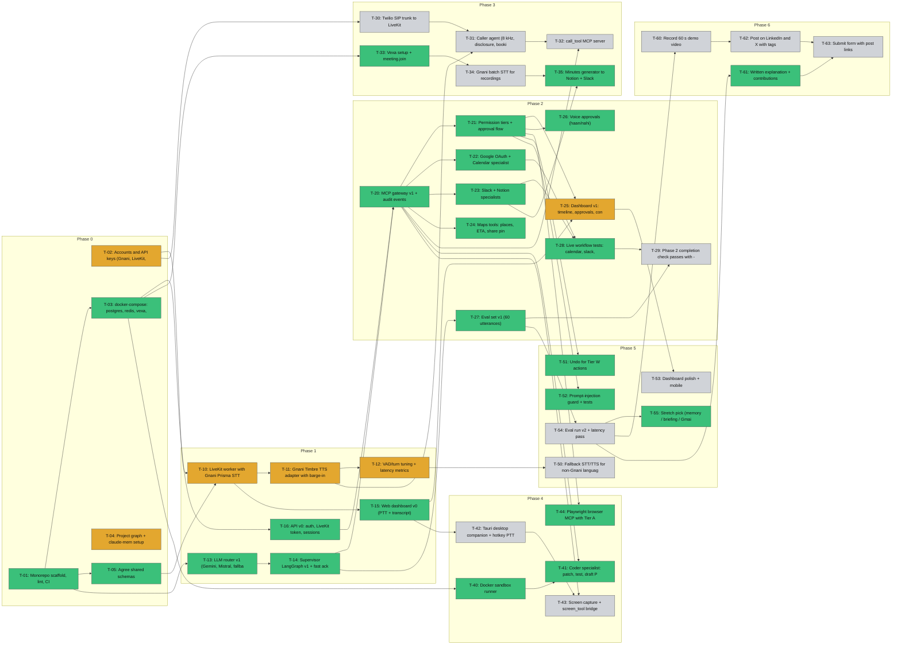

# Progress — Rex

_Generated by `scripts/progress.py` from `memory/project-graph.jsonl` on 2026-10-25. Do not edit by hand — update the graph and re-run._

**Overall:** `█████████████░░░░░░░   63%` · **Days to deadline:** 16 (10 Nov 2026, 23:59 IST)

| Status | Count |
|---|---|
| ✅ done | 24 |
| 🟨 in_progress | 6 |
| 🟥 blocked | 0 |
| ⬜ todo | 13 |

## By phase

| Phase | Window | Progress | Gate |
|---|---|---|---|
| Phase 0 — Setup + accounts | 2026-10-24..2026-10-25 | `████████░░   80%` | G0: both run make dev |
| Phase 1 — Voice loop + supervisor | 2026-10-25..2026-10-27 | `████████░░   79%` | G1: Hindi answer < 2 s |
| Phase 2 — Core tools + dashboard v1 | 2026-10-28..2026-10-31 | `████████░░   85%` | G2: demo steps 1+3; scope freeze |
| Phase 3 — Caller + Meeting | 2026-11-01..2026-11-04 | `███░░░░░░░   33%` | G3: demo steps 1-3 |
| Phase 4 — Coder + Screen + Browser | 2026-11-03..2026-11-06 | `██████░░░░   60%` | G4: demo step 4 |
| Phase 5 — Safety, polish, languages, evals | 2026-11-05..2026-11-07 | `█████░░░░░   50%` | G5: demo 10/10 |
| Phase 6 — Demo, post, submit | 2026-11-08..2026-11-10 | `██░░░░░░░░   25%` | Submitted by 10 Nov 23:59 IST |

## By person

| Person | Tasks | Progress |
|---|---|---|
| Johny | 21 | `███░░░░░░░   29%` |
| Shanky | 26 | `████████░░   85%` |

## In progress

- **T-02** Accounts and API keys (Gnani, LiveKit, Twilio, Google, Slack, Notion, GitHub, Gemini, Mistral) — Johny
- **T-04** Project graph + claude-mem setup — Johny
- **T-10** LiveKit worker with Gnani Prisma STT — Johny
- **T-11** Gnani Timbre TTS adapter with barge-in — Johny
- **T-12** VAD/turn tuning + latency metrics — Johny
- **T-25** Dashboard v1: timeline, approvals, connections — Johny

## Blocked

- none

## Ready to start (all dependencies done)

- **T-29** Phase 2 completion check passes with --live (S2-7) — Shanky
- **T-34** Gnani batch STT for recordings — Johny
- **T-42** Tauri desktop companion + hotkey PTT — Johny
- **T-54** Eval run v2 + latency pass — Johny, Shanky

## Dependency map

## All tasks

| Task | Title | Owner | Phase | Status |
|---|---|---|---|---|
| T-01 | Monorepo scaffold, lint, CI | Shanky | Phase 0 | ✅ done |
| T-02 | Accounts and API keys (Gnani, LiveKit, Twilio, Google, Slack, Notion, GitHub, Gemini, Mistral) | Johny | Phase 0 | 🟨 in_progress |
| T-03 | docker-compose: postgres, redis, vexa, langfuse | Shanky | Phase 0 | ✅ done |
| T-04 | Project graph + claude-mem setup | Johny | Phase 0 | 🟨 in_progress |
| T-05 | Agree shared schemas | Johny, Shanky | Phase 0 | ✅ done |
| T-10 | LiveKit worker with Gnani Prisma STT | Johny | Phase 1 | 🟨 in_progress |
| T-11 | Gnani Timbre TTS adapter with barge-in | Johny | Phase 1 | 🟨 in_progress |
| T-12 | VAD/turn tuning + latency metrics | Johny | Phase 1 | 🟨 in_progress |
| T-13 | LLM router v1 (Gemini, Mistral, fallback) | Shanky | Phase 1 | ✅ done |
| T-14 | Supervisor LangGraph v1 + fast ack | Shanky | Phase 1 | ✅ done |
| T-15 | Web dashboard v0 (PTT + transcript) | Johny | Phase 1 | ✅ done |
| T-16 | API v0: auth, LiveKit token, sessions | Shanky | Phase 1 | ✅ done |
| T-20 | MCP gateway v1 + audit events | Shanky | Phase 2 | ✅ done |
| T-21 | Permission tiers + approval flow | Shanky | Phase 2 | ✅ done |
| T-22 | Google OAuth + Calendar specialist | Shanky | Phase 2 | ✅ done |
| T-23 | Slack + Notion specialists | Shanky | Phase 2 | ✅ done |
| T-24 | Maps tools: places, ETA, share pin | Shanky | Phase 2 | ✅ done |
| T-25 | Dashboard v1: timeline, approvals, connections | Johny | Phase 2 | 🟨 in_progress |
| T-26 | Voice approvals (haan/nahi) | Johny | Phase 2 | ✅ done |
| T-27 | Eval set v1 (60 utterances) | Shanky | Phase 2 | ✅ done |
| T-28 | Live workflow tests: calendar, slack, notion, standup (S2-4) | Shanky | Phase 2 | ✅ done |
| T-29 | Phase 2 completion check passes with --live (S2-7) | Shanky | Phase 2 | ⬜ todo |
| T-30 | Twilio SIP trunk to LiveKit | Johny | Phase 3 | ⬜ todo |
| T-31 | Caller agent (8 kHz, disclosure, booking) | Johny | Phase 3 | ⬜ todo |
| T-32 | call_tool MCP server | Johny | Phase 3 | ⬜ todo |
| T-33 | Vexa setup + meeting.join | Shanky | Phase 3 | ✅ done |
| T-34 | Gnani batch STT for recordings | Johny | Phase 3 | ⬜ todo |
| T-35 | Minutes generator to Notion + Slack | Shanky | Phase 3 | ✅ done |
| T-40 | Docker sandbox runner | Shanky | Phase 4 | ✅ done |
| T-41 | Coder specialist: patch, test, draft PR | Shanky | Phase 4 | ✅ done |
| T-42 | Tauri desktop companion + hotkey PTT | Johny | Phase 4 | ⬜ todo |
| T-43 | Screen capture + screen_tool bridge | Johny | Phase 4 | ⬜ todo |
| T-44 | Playwright browser MCP with Tier A | Shanky | Phase 4 | ✅ done |
| T-50 | Fallback STT/TTS for non-Gnani languages | Johny | Phase 5 | ⬜ todo |
| T-51 | Undo for Tier W actions | Shanky | Phase 5 | ✅ done |
| T-52 | Prompt-injection guard + tests | Shanky | Phase 5 | ✅ done |
| T-53 | Dashboard polish + mobile | Johny | Phase 5 | ⬜ todo |
| T-54 | Eval run v2 + latency pass | Johny, Shanky | Phase 5 | ⬜ todo |
| T-55 | Stretch pick (memory / briefing / Gmail) | Shanky | Phase 5 | ✅ done |
| T-60 | Record 60 s demo video | Johny | Phase 6 | ⬜ todo |
| T-61 | Written explanation + contributions | Shanky | Phase 6 | ✅ done |
| T-62 | Post on LinkedIn and X with tags | Johny, Shanky | Phase 6 | ⬜ todo |
| T-63 | Submit form with post links | Johny, Shanky | Phase 6 | ⬜ todo |
