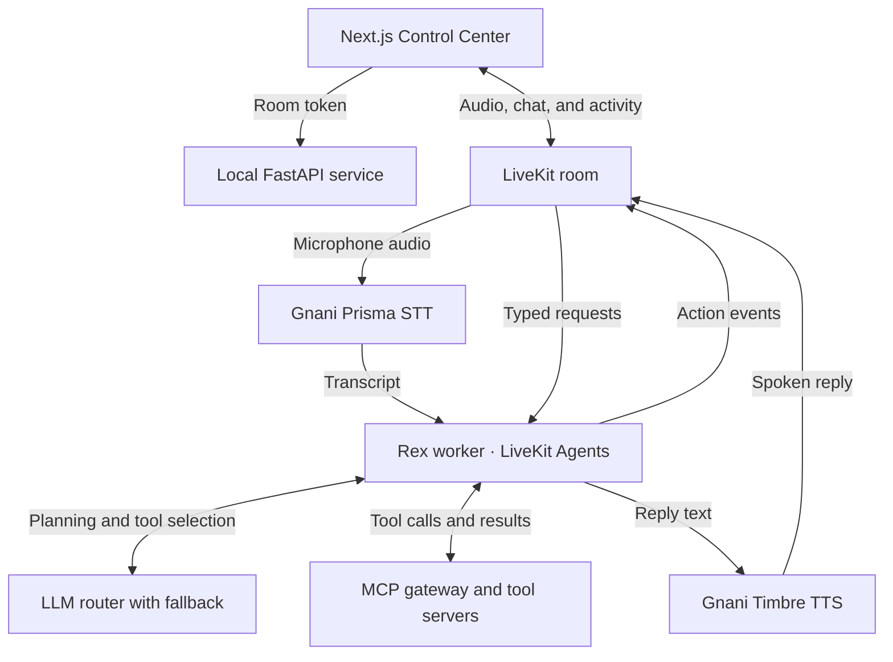

<h1 align="center">
  <picture>
    <source media="(prefers-color-scheme: dark)" srcset="docs/brand/rex-lockup-dark.svg">
    
  </picture>
</h1>

Rex is a personal AI assistant you can speak to or type to. It uses the browser and your Mac apps to carry out tasks, reports what happened, and remembers useful details between conversations. Gnani Prisma and Timbre power the voice experience, including conversations in Hinglish when multilingual mode is enabled.

https://github.com/user-attachments/assets/0ca531b8-fdf7-4939-ac61-f601bd4dc281

## What Rex does

- **Research and share.** Find information on the web, summarize it with source links, and share it through WhatsApp on macOS or Gmail. For WhatsApp, Rex checks the intended chat before sending and looks for the new message afterward.
- **Work across apps.** Read Gmail and Slack, manage Google Calendar events, create or update Notion pages, and navigate and fill forms with Playwright. Rex can also answer questions about a screen you choose to share and interact with Mac apps through their accessibility controls.
- **Save and reuse work.** Keep notes and downloads in Files, remember facts and session summaries, and run reusable routines such as a daily briefing from your calendar and unread mail. Discover looks for new links related to your saved interests when background research is configured.
- **Show its actions.** The Control Center displays the transcript, activity, and approval requests. Actions such as sending email or submitting a browser form require confirmation by voice or in the dashboard. Some changes, such as creating a calendar event, support undo.

## Architecture

The agent worker runs the conversation, calls tools, and sends results back to the room. Reusable routines check each result before moving to the next step. The MCP gateway uses its registry to determine which tools are available and which require approval. [Agent worker](apps/agent/src/rex_agent/main.py) · [Built-in routines](infra/pipelines.yaml) · [MCP registry](infra/mcp_servers.yaml)

The local FastAPI service issues LiveKit room tokens and serves the dashboard's connections, memory, Files, and Discover views. The dashboard receives live activity and sends approval decisions through LiveKit. [API](apps/api/src/rex_api/main.py) · [Dashboard](apps/web/README.md)

## How Rex uses Gnani

1. **Prisma handles incoming speech.** Rex plugs Gnani speech-to-text into its LiveKit agent session and streams microphone audio at 16 kHz. It requests transcription mode so values such as dates, numbers, and currency are normalized before the model handles the request.
2. **Timbre speaks the response.** The same session sends reply text to Gnani Timbre v3.0 and streams the audio back to the room. Rex defaults to the Lakshmi voice and streams synthesis over SSE. LiveKit handles turn detection and lets the user interrupt a spoken reply.
3. **Rex adapts the reply language.** English is the default. With `REX_ENGLISH_ONLY=0`, Prisma defaults to `hi-IN` for Hinglish input. Rex uses the transcript to detect the turn's language and updates Timbre's language for the reply.

[Gnani speech adapters](apps/agent/src/rex_agent/models.py) · [Voice settings](apps/agent/src/rex_agent/config.py)
