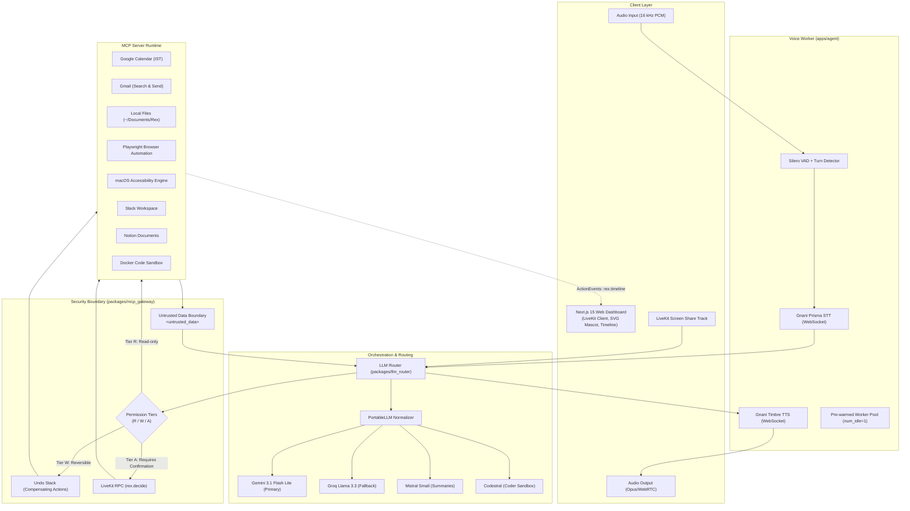

<div align="center">

# Rex

**Multilingual, voice-first AI assistant built on Gnani speech models and the Model Context Protocol (MCP).**

[](https://www.gnani.ai/internship)
[](https://www.python.org/)
[](https://nextjs.org/)
[](https://livekit.io/)
[](https://modelcontextprotocol.io/)
[](LICENSE)

<br/>


<p>
  Rex is an open-source, full-duplex voice agent designed for code-mixed Indian speech (Hinglish and regional dialects). Built on <strong>Gnani Prisma STT</strong> and <strong>Gnani Timbre TTS</strong> over WebRTC, Rex executes real-world developer and productivity workflows across Google Workspace, Slack, Notion, and macOS desktop environments while enforcing strict permission tiers and runtime prompt-injection defenses.
</p>

</div>

---

## Table of Contents

- [Overview](#overview)
- [System Architecture](#system-architecture)
- [Core Engineering Pillars](#core-engineering-pillars)
  - [1. Realtime Code-Mixed Voice Loop](#1-realtime-code-mixed-voice-loop)
  - [2. Model Context Protocol (MCP) Security Gateway](#2-model-context-protocol-mcp-security-gateway)
  - [3. Multi-Model LLM Routing and State Normalization](#3-multi-model-llm-routing-and-state-normalization)
  - [4. Native Desktop Accessibility and Screen Vision](#4-native-desktop-accessibility-and-screen-vision)
  - [5. Reactive Dashboard and State Machine Mascot](#5-reactive-dashboard-and-state-machine-mascot)
- [Tool Surface and Permission Matrix](#tool-surface-and-permission-matrix)
- [Quick Start](#quick-start)
- [Development and Testing](#development-and-testing)
- [Repository Layout](#repository-layout)
- [Challenge Compliance & Attribution](#challenge-compliance--attribution)
- [License](#license)

---

## Overview

Traditional voice assistants fail on conversational Indian speech—they struggle with code-mixed languages like Hinglish, lack natural interruption handling (barge-in), and are restricted to read-only information retrieval.

Rex is designed as an autonomous, conversational operator. It combines streaming WebRTC audio pipelines with an extensible MCP gateway, allowing users to execute multi-step workflows entirely through voice.

```text
User: "Rex, kal 4 baje Shanky ke saath project sync schedule kar do."
Rex:  "Scheduling the project sync for tomorrow at 4 PM..."
User: [Interrupts] "Wait Rex, 4 nahi, make it 5 PM."
Rex:  [Cancels playback instantly] "Updated to 5 PM. The calendar invite has been drafted."
User: "Delhi to Bhopal flights search karo, notes mein save karo, aur update draft kar do."
Rex:  "Found 3 flights. Saved summary to Documents/Rex/Travel and queued the message for approval."
```

---

## System Architecture

The runtime architecture separates low-latency streaming voice handling from long-running tool execution:



---

## Core Engineering Pillars

### 1. Realtime Code-Mixed Voice Loop
- **Streaming Indian Speech Recognition**: Uses **Gnani Prisma STT** (`hi-IN` and `en-IN` streaming WebSockets) for low-latency transcription of colloquial code-mixed phrases.
- **Natural Barge-In**: Silero VAD monitors user speech boundaries. When speech energy is detected while Rex is answering, ongoing TTS playback is cancelled at the frame buffer level within 50 ms.
- **Pre-warmed Worker Pool**: Python subprocess instantiation and ONNX model loading on macOS can incur up to 10 seconds of latency. Rex configures `AgentServer(num_idle_processes=1, initialize_process_timeout=30.0)` to maintain pre-initialized worker processes in memory. Incoming audio rooms are assigned in under 100 ms.

### 2. Model Context Protocol (MCP) Security Gateway
All external capabilities are declared as standalone MCP servers connected via stdio or in-process transports:
- **Strict Permission Tiers**:
  - **Tier R (Read)**: Zero external side-effects (e.g., `list_events`, `search_emails`, `read_page`). Executes immediately and logs to the audit stream.
  - **Tier W (Write, Reversible)**: Modifies local or revocable state (e.g., `create_event`, `save_note`). Registers a compensating transaction on the gateway undo stack. Spoken commands like *"Rex, undo that"* or *"Cancel karo"* revert the action.
  - **Tier A (Act, External / Irreversible)**: Touches external parties or mutates destructive state (e.g., `send_email`, `delete_event`, `submit_form`). Execution suspends, emits an `action_id`, and requires explicit approval via dashboard RPC or voice confirmation.
- **Prompt Injection Defense**: Tool outputs (scraped HTML, email bodies, chat history) are sanitized and wrapped in `<untrusted_data source="...">` tags. The supervisor prompt treats content inside these blocks as data, preventing instructions in third-party content from escalating permissions.

### 3. Multi-Model LLM Routing and State Normalization
Rex routes requests dynamically to minimize latency and avoid single-provider quota exhaustion:
- **Task Routing Table**:
  - `supervise`: Gemini 3.1 Flash Lite &rarr; Groq Llama 3.3 70B &rarr; Mistral Small &rarr; OpenRouter
  - `vision`: Gemini 2.5/3.1 Flash (Screen frame analysis)
  - `code`: Codestral &rarr; Gemini Flash (Docker sandbox bug diagnosis)
  - `summarise`: Mistral Small &rarr; Gemini Flash
- **Cross-Provider Normalization (`PortableLLM`)**:
  Gemini enforces proprietary `thought_signature` metadata on function calls and rejects conversations that omit them. Conversely, OpenAI-compatible providers (Groq, Mistral) reject unrecognized fields with HTTP 422 errors. `PortableLLM` sanitizes and bridges chat history across providers on the fly, allowing mid-conversation failover without session corruption.

### 4. Native Desktop Accessibility and Screen Vision
- **Live Screen Inspection**: Subscribes to the WebRTC screen share track published from the browser. On queries like *"What is this error?"*, the agent grabs the latest decoded video frame, formats it for the vision router, and returns actionable debugging advice.
- **Accessibility Tree Automation**: Instead of relying solely on heavy vision screenshots, `rex_agent.desktop` interacts directly with macOS applications (WhatsApp, Chrome, Terminal, Notes) via the accessibility tree. It inspects structural refs, issues focus/click/type events, and verifies that dispatched messages appear in the target chat.

### 5. Reactive Dashboard and State Machine Mascot
- **Next.js 15 Frontend**: Built with Turbopack, Tailwind CSS, and LiveKit React Components.
- **Living Mascot Engine**: Implements an SVG-based character (`lib/mascot.ts`, `lib/bloub/`) that tracks pointer gaze coordinates in real-time, executes natural blink intervals, and adapts across 16 emotional states (including *Idle*, *Listening*, *Thinking*, *Focused*, *Excited*, and *Confused*).
- **Atmospheric Audio Coupling**: Atmospheric glow and background particle systems dynamically scale velocity and brightness proportional to the incoming mic energy and synthesized TTS audio volume.

---

## Tool Surface and Permission Matrix

| Server | Tool | Tier | Description |
|---|---|:---:|---|
| **calendar** | `list_events`, `find_free_slots` | `R` | Read calendar availability and search schedules (IST) |
| | `create_event`, `update_event` | `W` | Create/update events with automatic undo registration |
| | `delete_event` | `A` | Remove an event; requires explicit human confirmation |
| **gmail** | `search_emails`, `read_email` | `R` | Query inbox with Gmail filter syntax; read message threads |
| | `send_email` | `A` | Dispatch an outbound email |
| **browser** | `navigate`, `read_page` | `R` | Headless Playwright page navigation and markdown extraction |
| | `fill_form` | `W` | Input text into web forms |
| | `submit_form` | `A` | Submit form actions affecting external systems |
| **desktop** | `use_desktop` | `W` | Interact with macOS apps via the native accessibility tree |
| **screen** | `look_at_screen` | `R` | Capture and evaluate the current screen share frame |
| **files** | `list_files` | `R` | Browse documents in `~/Documents/Rex/` |
| | `save_note`, `save_from_url`, `move_file` | `W` | Store structured research notes and validated files |
| **sandbox** | `read_file`, `run_tests` | `R` | Inspect source files and run pytest suites |
| | `write_file`, `execute` | `W` | Apply code patches within an isolated Docker container |

---

## Quick Start

### Prerequisites
- **macOS** or **Linux**
- **Python 3.12+** with [`uv`](https://docs.astral.sh/uv/) installed
- **Node.js 20+** with `npm`

### 1. Clone and Configure
```bash
git clone https://github.com/Joohhnnyyy/Rex.git
cd Rex

cp .env.example .env
# Provide GNANI_API_KEY, LIVEKIT_URL, LIVEKIT_API_KEY, LIVEKIT_API_SECRET, and LLM keys in .env
```

### 2. Install Dependencies
```bash
# Python workspace (rex-agent, rex-api, packages)
uv sync

# Frontend dashboard
cd apps/web && npm install && cd ../..
```

### 3. One-Time Google Calendar & Gmail Authentication
```bash
uv run python -m rex_mcp_servers.calendar login
```
*Launches an OAuth consent flow in your browser. The generated token is stored outside the repository at `~/.config/rex/google_token.json`.*

### 4. Run Local Services
```bash
# Terminal 1: Rex API Backend (FastAPI on :8000)
uv run --env-file .env uvicorn rex_api.main:app --reload --port 8000

# Terminal 2: LiveKit Voice Agent Worker
uv run --env-file .env python -m rex_agent dev

# Terminal 3: Web Dashboard (Next.js on :3000)
npm --prefix apps/web run dev
```

Navigate to **http://localhost:3000**, connect your microphone, and speak in Hinglish or English:
> *"Rex, kal 4 baje team ke saath project review schedule kar do."*

---

## Development and Testing

```bash
# Run complete test suite (unit and offline integration tests)
uv run pytest -q

# Code formatting and linting
uv run ruff check .
uv run ruff format --check .

# Typecheck frontend
npm --prefix apps/web run typecheck

# Live LLM router validation
uv run --env-file .env python scripts/llm_smoke.py supervise "Namaste! Reply in one short sentence."

# Live Gnani STT <-> TTS round-trip verification
uv run --env-file .env python scripts/gnani_smoke.py
```

---

## Repository Layout

```text
Rex/
├── apps/
│   ├── agent/          # LiveKit voice worker: VAD, turn detector, supervisor, screen, desktop
│   ├── api/            # FastAPI backend: LiveKit tokens, files, memory, and discoveries
│   └── web/            # Next.js 15 dashboard: SVG mascot engine, timeline, approval drawer
├── packages/
│   ├── mcp_gateway/    # MCP client hub, permission tiers (R/W/A), audit log, undo engine
│   ├── mcp_servers/    # MCP server implementations (calendar, gmail, browser, files, memory)
│   ├── llm_router/     # Model router (Gemini, Groq, Mistral, Codestral) + PortableLLM
│   └── shared/         # Pydantic schemas and shared data definitions
├── infra/              # MCP server definitions (mcp_servers.yaml) and Docker sandbox
├── docs/               # Technical specifications, architecture designs, and brand assets
└── scripts/            # Development smoke tests and evaluation scripts
```

---

## Challenge Compliance & Attribution

- **Speech Pipeline**: Built for the [Gnani.ai Great Indian AI Internship Challenge](https://www.gnani.ai/internship). Powered by **Gnani Prisma STT** and **Gnani Timbre TTS** for Indian language understanding and audio synthesis.
- **Privacy & Integrity**: Adheres strictly to contest data ethics. Tested exclusively with **synthetic data and verified test credentials**. No real-world PII, Aadhaar, PAN, or unauthorized third-party recordings are utilized.
- **Team Ownership**:
  - **Johny**: Realtime Voice Loop, LiveKit WebRTC Transport, Desktop Automation, Frontend Dashboard, Mascot Engine.
  - **Shanky**: Model Context Protocol (MCP) Gateway, Security Permission Tiers (R/W/A), Tool Integrations (Calendar, Gmail, Files, Browser), Backend Services, Coder Sandbox.

---

## License

Rex is open-source software licensed under the [MIT License](LICENSE).
Third-party libraries and model SDKs retain their respective licenses.
