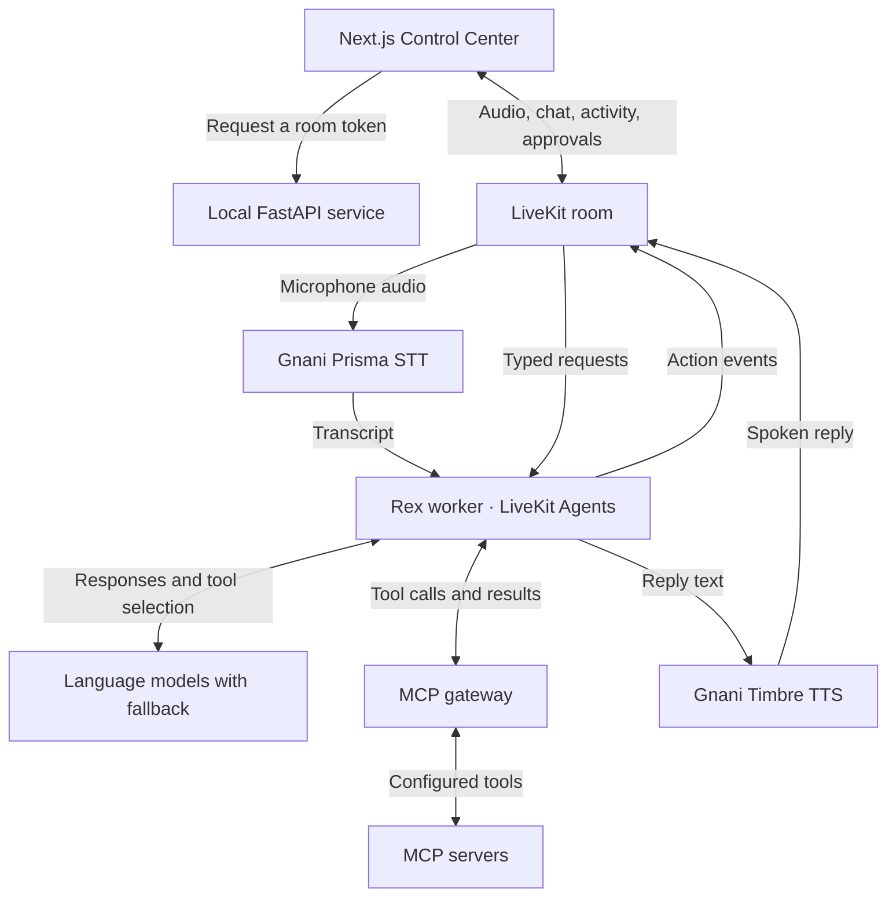

<h1 align="center">
  <picture>
    <source media="(prefers-color-scheme: dark)" srcset="docs/brand/rex-lockup-dark.svg">
    
  </picture>
</h1>

<strong>A voice-first assistant for the web and macOS.</strong>

Rex takes a spoken or typed request and carries it out across connected services, the browser, and Mac apps. The Control Center shows the conversation and the actions Rex takes, including requests for approval. Gnani Prisma transcribes speech and Gnani Timbre speaks the response in the same LiveKit session.

https://github.com/user-attachments/assets/0ca531b8-fdf7-4939-ac61-f601bd4dc281

## What Rex can do

| Capability | What you can ask Rex to do |
| --- | --- |
| **Web research** | Search for a topic, read a page, and summarize findings with source links. Save the write-up in Files or share it through a connected app. |
| **Messaging and scheduling** | Find and summarize Gmail or Slack messages, send email, post to Slack, find open slots in Google Calendar, or create an event. |
| **Notes and places** | Search and read Notion pages, create a page or append notes, find a place, or estimate driving time. |
| **Browser and Mac apps** | Navigate and fill web forms with Playwright, interact with a Mac app through its accessibility tree, or answer a question about a screen you share. |
| **Memory and discovery** | Recall a saved preference or a previous session summary, save a note for later, or find new links related to your interests. |

## A request from start to finish

> “Find a few good articles about accessibility testing and send the links to Shanky on WhatsApp.”

1. **Hear the request.** The dashboard sends microphone audio through LiveKit. Gnani Prisma transcribes it, and the language model selects the built-in `share_research` routine.
2. **Find and draft.** The routine searches through Firecrawl and passes the results to a writing step. The writing prompt asks for a short message using only the returned results and links.
3. **Send and verify.** Rex uses the WhatsApp Mac app's accessibility tree to confirm the target chat before sending. It then checks that the newest outgoing message matches the start of the draft. If the send might have happened but Rex cannot verify it, the routine reports that uncertainty and stops.
4. **Report the outcome.** Rex publishes routine and tool activity to the Control Center. Gnani Timbre reads the result aloud.

The same runner powers routines for email research, a spoken briefing from Calendar and unread Gmail, and research notes saved to Files. Routines declare their inputs and steps in YAML. The runner checks each step before continuing and stops on a failure or a pending approval. Rex can also save user-defined routines locally. [Built-in routines](infra/pipelines.yaml) · [Routine runner](apps/agent/src/rex_agent/pipelines.py) · [Mac app tools](apps/agent/src/rex_agent/desktop.py)

## Architecture

| Component | Responsibility |
| --- | --- |
| **Control Center** | Joins a LiveKit room, sends microphone audio or typed requests, and displays the transcript, browser view, and activity. Approval buttons send decisions back to the agent through LiveKit RPC. [Dashboard](apps/web/README.md) |
| **FastAPI service** | Mints short-lived LiveKit tokens that dispatch the Rex worker. It also serves the dashboard's Connections, Memory, Files, and Discover views and runs the background discovery schedule. [API](apps/api/src/rex_api/main.py) · [Token endpoint](apps/api/src/rex_api/livekit_tokens.py) |
| **Agent worker** | Owns the conversation and wires speech, language models, and tools into a LiveKit agent session. It publishes action events, runs routines, and saves a short summary at the end of a session. [Worker](apps/agent/src/rex_agent/main.py) |
| **Model routing** | Builds a fallback chain from configured providers. The voice session keeps conversation history usable across providers, while the shared router supplies model chains for work such as writing summaries or interpreting a screen image. [Voice model adapters](apps/agent/src/rex_agent/models.py) · [Task router](packages/llm_router/src/rex_llm_router/router.py) |
| **MCP gateway and servers** | Expose selected tools to the agent, enforce access and approval rules, and publish action events. Servers connect to services such as Google Calendar and Gmail or to local tools such as Playwright and Mac accessibility. [Gateway](packages/mcp_gateway/src/rex_mcp_gateway/gateway.py) · [Tool registry](infra/mcp_servers.yaml) |

### Tool permissions and approvals

| Tier | How it runs | Example |
| --- | --- | --- |
| **R · Read** | Runs as soon as Rex calls the tool. | List Calendar events or search Gmail. |
| **W · Write** | Runs immediately. Tools with a configured reverse action support undo. | Create a Calendar event and undo it by removing the event. |
| **A · Approval** | The gateway holds the call until the user approves it by voice or in the dashboard. | Send email, post to Slack, or submit a browser form. |

The registry limits which tools each part of Rex can use. The gateway returns external tool text in an untrusted-data wrapper and emits activity events for the dashboard. Mac app actions have their own checks, such as verifying the target chat and the outcome of a WhatsApp send. [Gateway policy implementation](packages/mcp_gateway/src/rex_mcp_gateway/gateway.py) · [Tool tiers](infra/mcp_servers.yaml)

### Memory, Files, and Discover

- **Memory** stores user facts and short session summaries locally. Rex loads them into the context of later sessions. [Memory store](packages/mcp_servers/src/rex_mcp_servers/memory.py)
- **Files** keeps saved notes and downloads in a local library under `~/Documents/Rex` by default. The dashboard can open, move, or reveal items. [File library](packages/mcp_servers/src/rex_mcp_servers/files.py)
- **Discover** searches for recent results related to saved interests and shows selected links with a reason for each pick. It runs on demand or in the background when Firecrawl is configured. The background interval defaults to six hours. [Discovery scheduler](apps/api/src/rex_api/discover.py) · [Result selection](packages/mcp_servers/src/rex_mcp_servers/discoveries.py)

## How Rex integrates Gnani

Rex creates both speech adapters through the LiveKit Gnani plugin and passes them into the same `AgentSession` as the language model. Both adapters use `GNANI_API_KEY` and a default sample rate of 16 kHz. Prisma and Timbre handle the speech on either side of the model's reasoning and tool calls. [Speech adapters](apps/agent/src/rex_agent/models.py) · [Session setup](apps/agent/src/rex_agent/main.py)

| Stage | How it works in Rex |
| --- | --- |
| **Speech to text · Prisma** | Rex configures Prisma with `format="transcribe"` so dates, numbers, and currency are normalized in the transcript. LiveKit uses Silero voice activity detection and can use its multilingual turn detector to decide when the user has finished speaking. |
| **Language selection** | English is the default. With `REX_ENGLISH_ONLY=0`, the streaming recognizer defaults to `hi-IN` for Hinglish and can be configured for another input language with `REX_STT_LANGUAGE`. Rex detects language from each completed transcript and updates Timbre's reply language for that turn. |
| **Text to speech · Timbre** | Rex defaults to Timbre v3.0 with the Lakshmi voice and streams synthesized audio over SSE. Rex adds the language field to the plugin's Timbre v3 payload so the voice receives the intended language. LiveKit plays the audio in the room and handles interruptions when the user speaks again. |

[Voice defaults](apps/agent/src/rex_agent/config.py) · [Language detection](apps/agent/src/rex_agent/lang.py)
