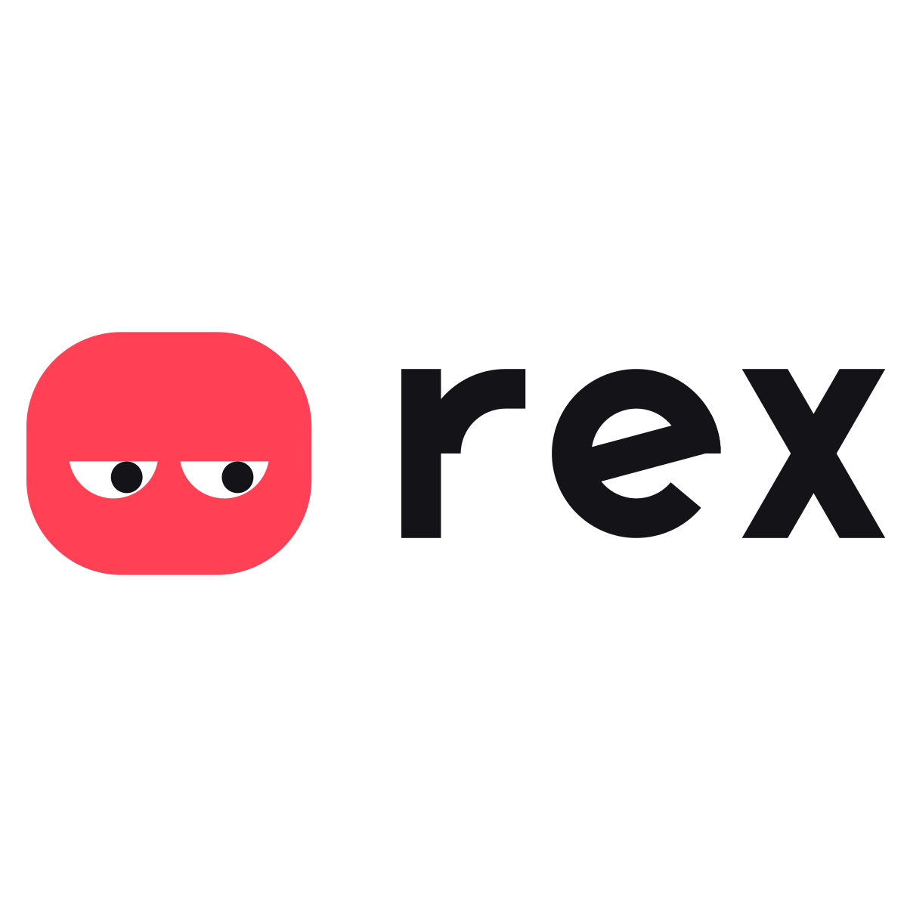

# Rex — Logo Guidelines

## 1. The logo
- **Idea:** Rex's face cut to its essence: heavy lids and a sideways glance. *Unimpressed, then it gets it done.*
  It is the product's mascot as a mark, so the dashboard, the app icon and every call show one face.
- **Versions:** horizontal (primary) · stacked · symbol · wordmark · small-size symbol (16–31 px).
- **The wordmark** is drawn, not typed: a custom geometric lowercase *rex* (stroke 30, x-height 128 on a 256 grid).
  Never retype it in a font.

| Use | File |
|---|---|
| Websites, slides, docs (light) | `masters/rex-horizontal-color.svg` |
| Dark backgrounds (dashboard, video) | `masters/rex-horizontal-color-dark.svg` |
| Square spaces, posters | `masters/rex-stacked-color.svg` / `-color-dark.svg` |
| Avatars, app tiles, symbol alone | `masters/rex-symbol-color.svg` |
| 16–31 px (favicons, tiny UI) | `masters/rex-symbol-small-color.svg` |
| One colour (print, stamps, embroidery) | `exports/*/…-black.svg`, `…-white.svg`, `…-mono-ff4055.svg` |
| Web icons (favicon, PWA, Apple) | `exports/symbol/` + `head-snippet.html` |
| PNGs | `exports/color/*.png`, `exports/*/…-<size>.png` |

## 2. Clear space
Keep a clear zone of **1 E** on every side, where **E = the width of one eye** (68 units on the 256 symbol grid, about a
quarter of the symbol's height). It scales with the logo — never use a fixed distance.

## 3. Minimum size
| Version | Screen | Print |
|---|---|---|
| Horizontal | 96 px wide | 25 mm wide |
| Stacked | 64 px wide | 18 mm wide |
| Symbol | 32 px | 8 mm |
| Small-size symbol (no pupils) | 16 px | 5 mm |

Below 32 px always use the small-size cut: the pupils blur into specks, so it drops them and enlarges the eyes.

## 4. Colour
| Name | HEX | RGB | CMYK | Pantone (nearest) | Use |
|---|---|---|---|---|---|
| Rex Red | `#FF4055` | 255 64 85 | 0 75 67 0 | 1787 C* | The face |
| Paper | `#FFFFFF` | 255 255 255 | 0 0 0 0 | — | Eyes, light backgrounds |
| Ink | `#141418` | 20 20 24 | 17 17 0 91 (or rich black) | Black 6 C* | Pupils, wordmark on light |
| Night | `#090A0D` | 9 10 13 | 31 23 0 95 | Black 6 C* | Dark backgrounds, app-icon tile |

\* Pantone matches are nearest equivalents: check against a physical swatch before printing.

**Contrast:** Ink on Paper 18.4:1 · Paper on Night 19.8:1 · Rex Red on Night 5.8:1 · Paper on Rex Red 3.4:1 (fine for the
logo and large text, not for small body text).

**Approved logo/background pairs:** colour on Paper · colour (white wordmark) on Night · white small-cut symbol on
Rex Red · black on Paper · white on Night. On photos use the white or black version on a calm area, or put the colour
symbol on its own rounded tile.

## 5. Typography
- **Logo:** the custom wordmark only (no font licence needed: the letters are drawn from geometry in `../build.py`).
- **Interface and documents:** Inter (SIL Open Font License), already used by the dashboard. Fallback: system UI sans.

## 6. Don'ts
Don't stretch, squash or rotate · don't tilt the lids (sloped lids read angry or sad; Rex is deadpan) · don't recolour
outside the palette · don't add shadows, outlines, gradients or glows · don't use the full symbol below 32 px · don't
rearrange or resize the parts of a lockup · don't place it on busy backgrounds without a tile · don't retype the
wordmark.

## 7. Motion (for the dashboard and video)
The lids are the system: a blink (lids down and up, 140 ms), a glance (pupils slide), and moods from lid height.
Keep the lids flat in the logo itself; animate them only in product UI.

---

## Handover notes
- **Rationale:** AI assistants cluster around blue orbs, sparkles, sound waves and robot heads. Faces with eyes exist
  (Discord, Twitch, Android); **heavy, flat lids don't**, and they carry Rex's personality. Three rounds on the lids:
  inward slope read angry, outward read sad, flat read deadpan.
- **Tests run:** SVG audit 100/100 on every one-colour master (colour masters flag their white eyes on purpose);
  16/24/32/64 px renders; one-colour, reversed and blur checks; mockups on app icon, site, social, browser tab, sticker
  and business cards (`presentation/rex-logo-board.html`, slides in `presentation/slides/`).
- **Rebuild:** `python3 ../build.py && python3 ../kit.py` regenerates every master from exact geometry; exports were made
  with the logo-design skill's `export_variants.py` (see the commands in the commit that added this kit).
- **Open items:** a professional trademark search before public launch; PDF/EPS print masters if a printer asks
  (export from the SVGs in Illustrator or Inkscape); a physical Pantone check.
