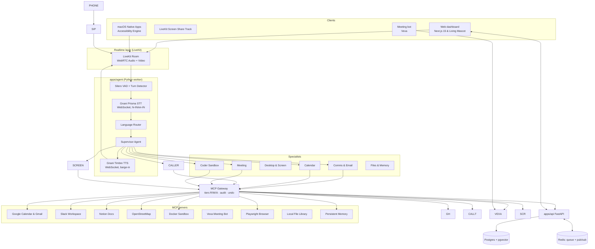
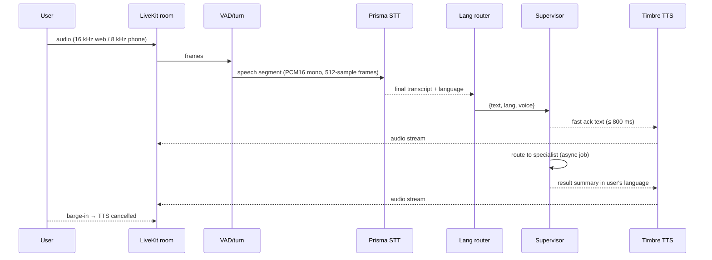
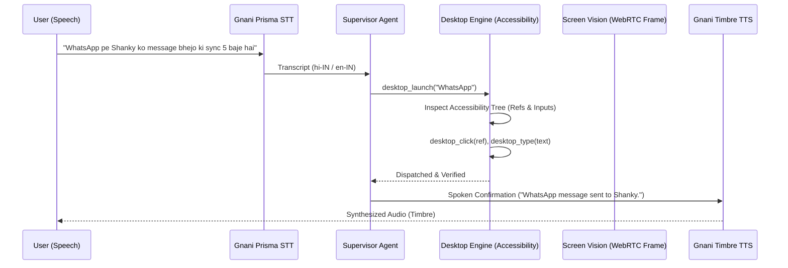
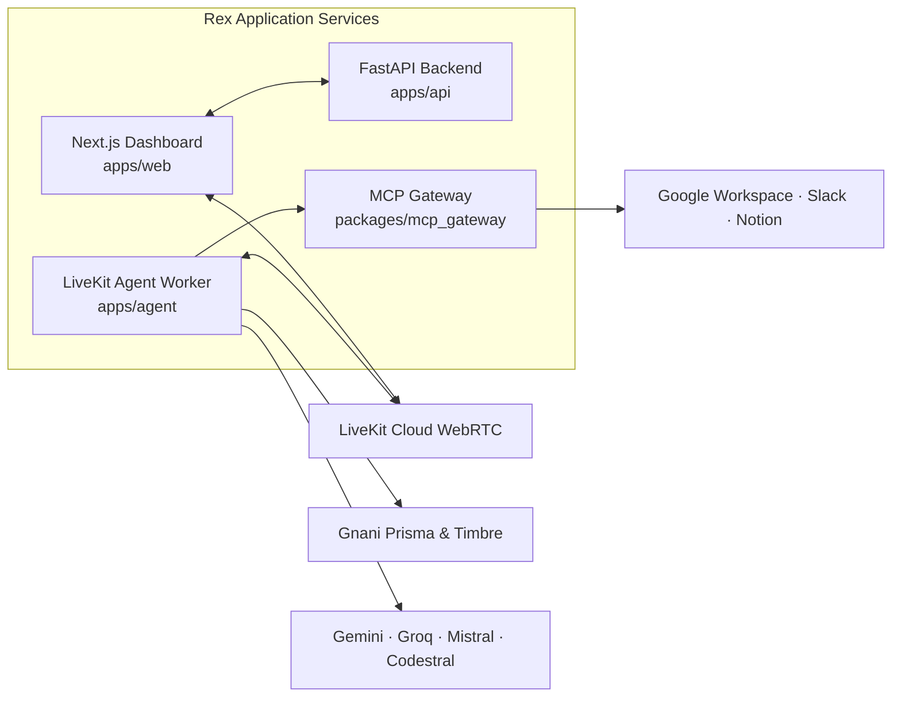

# Architecture — Rex

Status: v1 design, 24 Oct 2026. Owners: Johny (realtime + clients), Shanky (orchestration + tools + backend).

## 1. Principles

1. **Fast talker, slow thinker.** The voice loop never waits on a long task. It speaks a fast ack, hands the job to a background worker, and reports back.
2. **Supervisor + specialists.** One router agent, six specialists with small toolsets. Fewer tools per prompt = better tool choice and lower latency.
3. **Everything is MCP.** Every capability is an MCP tool behind one gateway. Adding a tool = adding config, not code.
4. **Permission tiers at the gateway**, not in prompts. The LLM cannot bypass them.
5. **Every action is an event.** Timeline, undo, debugging and the demo all read the same event stream.
6. **Gnani on every voice path.** Prisma for ears, Timbre for mouth; fallbacks only for languages Gnani does not cover.

## 2. System context



## 3. Components

### 3.1 Clients (Johny)

| Client | Tech | Responsibilities |
|---|---|---|
| Web dashboard | Next.js 15, `@livekit/components-react`, Tailwind | Join room, push-to-talk, live transcript, timeline, approvals, connections page, settings |
| Desktop companion | Tauri 2 (Rust + TS) | Tray icon, global hotkey push-to-talk, screen capture (region / active window), "watching" indicator, local `screen_tool` MCP server bridge |
| Phone | Twilio number → LiveKit SIP | Outbound calls placed by the Caller; stretch: inbound receptionist |
| Meeting bot | Vexa (self-host or hosted) | Joins Meet/Zoom/Teams, records, exposes transcripts + audio |

### 3.2 Realtime voice loop (Johny) — `apps/agent/voice/`



- Framework: **LiveKit Agents 1.x** with `livekit-plugins-gnani` (STT). TTS through the Gnani WebSocket API (custom LiveKit TTS adapter if no official TTS plugin; reference: `pipecat-gnani`'s `GnaniTTSService`).
- STT: Prisma via WebSocket, `format=transcribe` so dates/numbers come back normalised. 8 kHz for phone legs.
- Turn-taking: Silero VAD + LiveKit turn detector. Gnani sends **finals only**, so end-of-speech timing matters — tune `min_silence_duration` (start 450 ms).
- Barge-in: TTS is interruptible; on user speech the current utterance is cancelled and the supervisor is told what was actually spoken.

### 3.3 Language router (Johny) — `apps/agent/voice/lang.py`

| Detected language | STT | TTS | Notes |
|---|---|---|---|
| en-IN, hi-IN, bn, gu, kn, ml, mr, pa, ta, te (-IN) | Gnani Prisma | Gnani Timbre (matching voice) | Default path |
| Hinglish / code-mixed | Prisma `en-IN,hi-IN` bilingual (batch) or hi-IN streaming | Timbre Hindi voice | Supervisor keeps code-mixed style |
| Anything else (e.g. fr, es, ar, or Odia/Assamese if unsupported) | faster-whisper (local) | Fallback TTS (D-012) | Logged as "fallback" in metrics |

Language is locked per turn and stored on the session so replies match.

### 3.4 Supervisor and Specialists (Shanky) — `apps/agent/brain/`

- Orchestration: LiveKit native function tools with our `Supervisor` class (D-021). The supervisor exposes tools directly with strict JSON schema definitions while enforcing gateway security boundaries.
- Supervisor prompt holds: user profile, current time + timezone (Asia/Kolkata), language, short memory recall, and specialist instructions.
- Specialists and execution contexts:

| Specialist | Model (via llm_router) | MCP Tools | Tier Mix |
|---|---|---|---|
| Comms & Email | Gemini Flash Lite / Mistral | slack.*, gmail.* | R, A |
| Calendar | Gemini Flash Lite | calendar.freebusy/create/update/delete | R, W, A |
| Desktop & Screen | Gemini Flash Lite | desktop_*, look_at_screen | R, W |
| Meeting | Mistral Small | vexa.*, minutes.generate_minutes, notion.* | R, W, A |
| Coder | Codestral | sandbox.* (read/write/run_tests/execute) | R, W |
| Files & Memory | Gemini Flash Lite | files.*, memory.*, discoveries.* | R, W |

- **Fast ack rule**: when executing complex tools, the agent emits an immediate acknowledgement ("On it" / "Ek minute") before running the gateway call to avoid awkward voice silence.

### 3.5 LLM router (Shanky) — `packages/llm_router/`

```
route(task_kind, needs_vision, needs_code, lang) -> ModelSpec
```

| Task kind | Primary | Fallback |
|---|---|---|
| supervise / plan / tool-call | Gemini 2.x Flash (free tier) | Mistral Small |
| summarise / minutes / translate | Mistral Small | Gemini Flash |
| code | Codestral | Gemini |
| vision (screen) | Gemini Flash | — |
| any (rate-limited) | OpenRouter free model | — |

Router handles rate-limit (429) backoff and automatic fallback, and logs model + tokens per call.

### 3.6 Desktop Automation & Screen Vision (Johny) — `apps/agent/src/rex_agent/`



- Direct macOS accessibility tree inspection: accesses window elements, buttons, text inputs and lists via structural refs without pixel hallucination or OCR latency.
- WebRTC screen share vision: grabs live decoded video frames from the browser's screen share track for visual debugging and questions like *"What is this error?"*.

### 3.7 Meeting Pipeline (Shanky, STT by Johny)

1. `meeting.join(url)` → Vexa bot joins; announces recording.
2. Diarised transcript extracted from audio stream.
3. Mistral produces minutes: summary, decisions, action items (owner, due date), open questions — strict JSON schema.
4. Notion page created from template; Slack post with link; action items optionally become calendar holds (Tier W).

### 3.8 Coder Sandbox (Shanky)

- One Docker container per job from `infra/sandbox.Dockerfile` (git, python, node, test runners), workspace boundary enforced, network isolated.
- Loop: read file → patch → run pytest suite → retry up to 3 times.

### 3.9 Browser Automation (Shanky) — `rex_mcp_servers.browser`

- Headless Playwright engine with strict permission tier separation: page navigation (`navigate`) and reading (`read_page`) are Tier R; form typing (`fill_form`) is Tier W; form submission (`submit_form`) is Tier A requiring explicit user confirmation.

### 3.10 MCP Gateway (Shanky) — `packages/mcp_gateway/`

Responsibilities: connect to all servers (stdio / streamable HTTP), namespace tools, enforce tiers (R/W/A), inject OAuth tokens, timeouts + retry, write `action_events`, emit approval requests, support **undo** on Tier W actions where a compensating action exists. Detail: [MCP_CONNECTION.md](MCP_CONNECTION.md).

### 3.11 Backend API (Shanky) — `apps/api/`

FastAPI async service providing LiveKit room token minting, user connection credentials, file library indexing, and cross-session memory endpoints. Detail: [API.md](API.md).

## 4. Data Flow of One Request (Calendar & Travel Example)

1. Johny: "Rex, kal subah 10 baje Indiranagar mein client meeting schedule karo." (WebRTC, 16 kHz)
2. Prisma STT → `hi-IN` streaming transcript; language locked to Hinglish.
3. Supervisor → acknowledges immediately ("Ek minute, schedule karta hoon"), calls `calendar.create_event` (Tier W, registered on undo stack).
4. Supervisor calls `location.travel_time` (Tier R) to calculate driving time from current coordinates.
5. Supervisor speaks via Timbre TTS: "Kal subah 10 baje meeting schedule ho gayi. Indiranagar pahunchne mein lagbhag 35 minute lagenge."
6. Undo safety: if the user says "Rex, undo karo", the gateway pops the compensating action (`calendar.delete_event`) and reverts the change.

## 5. Deployment



- Dev: everything local via `docker compose` + LiveKit Cloud project.
- Demo: one VM (4 vCPU / 8 GB) in an Indian region; LiveKit Cloud for media; secrets via `.env` on the VM, never in git.

## 6. Observability

- **Langfuse** (self-hosted or cloud free) traces: one trace per user turn, spans for STT, router, each LLM call, each tool call, TTS.
- Metrics per turn: `stt_ms`, `llm_first_token_ms`, `tts_first_audio_ms`, `total_ms`, `lang`, `fallback_used`.
- Structured JSON logs with `session_id`, `turn_id`, `job_id`. See [DEBUGGING.md](DEBUGGING.md).

## 7. Failure modes and responses

| Failure | Response |
|---|---|
| STT timeout / empty | "Maaf kijiye, phir se boliye?" |
| LLM 429 | Router falls back to next model; spoken ack unaffected |
| Tool timeout | One retry, then honest spoken failure + timeline card with "retry" |
| Call not answered | Report "no answer", offer to retry in 10 min |
| Approval not given within 30 s | Action cancelled, logged |
| Sandbox tests fail 3× | Draft PR not opened; summary of attempts spoken |
